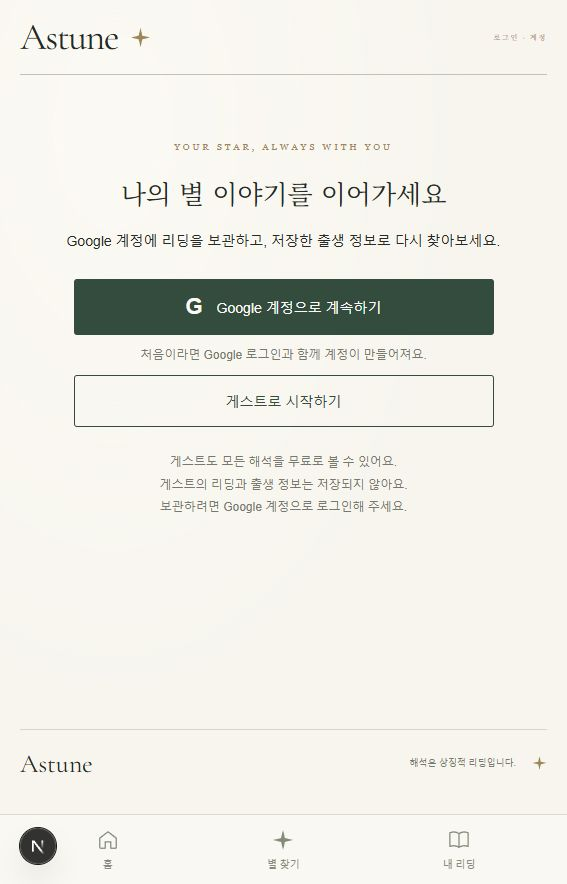

# T401–T404 · T501–T504 검증

2026-10-13, Windows 로컬 환경.

- `npm test`: 49개 통과, 실패·생략 0. 실제 서명된 Better Auth 테스트 세션과 임시 SQLite를 사용해 소유권, 게스트 401, 세션 폐기, 프로필 재사용, 페이지 조회, 스냅샷 불변성, 관리자 권한·규칙·감사 기록을 검증했습니다. Google 통신은 수행하지 않았습니다.
- `ASTUNE_NEXT_DIST_DIR=.audit-tmp/t401-next`로 분리한 `next build --webpack`: 컴파일·TypeScript·14개 정적 페이지 생성 통과. 실행 중인 개발 서버의 생성 폴더와 충돌하지 않도록 분리했습니다.
- SQLite 백업·복원에서 ID·시간·JSON·행 일치, 대상 데이터가 있는 경우 거절, 제약 오류 전체 롤백을 확인했습니다. PostgreSQL SQL은 PGlite에서 migration/rollback/seed 데이터 이관/제약을 검증했습니다. 외부 PostgreSQL 서버의 Prisma 접속 검증은 미실시입니다.
- 기본 상세 해석은 16개 성좌와 fallback에서 5개 영역 각각 3문단·400자 이상, 미치환 변수 없음이 확인됐습니다.

## 실제 브라우저 확인

분리된 프로덕션 서버 `127.0.0.1:3104`와 기존 Python 계산 서버를 사용했습니다.

1. 로그인 화면에서 Google·게스트 진입 및 ‘게스트의 리딩과 출생 정보는 저장되지 않아요’ 안내를 확인했습니다.
2. 게스트로 진입해 예시 입력(1995-05-05 15:00 서울)으로 Capella의 상세 해석을 생성했습니다.
3. 결과의 저장·보관 **버튼은 0개**, Google 로그인 링크와 저장되지 않는다는 안내만 표시됐습니다.
4. 새로고침 후 계산 결과가 사라지고 초기 입력 화면으로 돌아왔습니다.
5. ‘내 리딩’은 로그인 안내만 표시하고 브라우저 보관함을 제공하지 않았습니다.
6. 이 흐름의 브라우저 오류·경고 로그는 없었습니다. 소스에도 localStorage/sessionStorage 접근이 남아 있지 않습니다.

기존 3000 포트 개발 서버에서는 Turbopack 클라이언트의 이전 화면 코드와 서버 HTML이 섞이는 hydration 오류가 있었습니다. 생성 캐시를 별도 보관하고 개발 서버를 webpack으로 전환했습니다. 현재 `localhost:3000/login`에서도 최신 로그인·게스트 안내와 오류 배지 없는 화면을 확인했습니다. `npm run dev`에도 같은 옵션을 적용했습니다.

OAuth 클라이언트가 아직 없으므로 실제 Google 가입·로그인의 마지막 콜백은 검증하지 않았습니다. [설정 안내](../google-login.md)에 발급·환경 변수·관리자 부여·로그인 검증 절차를 정리했습니다.
